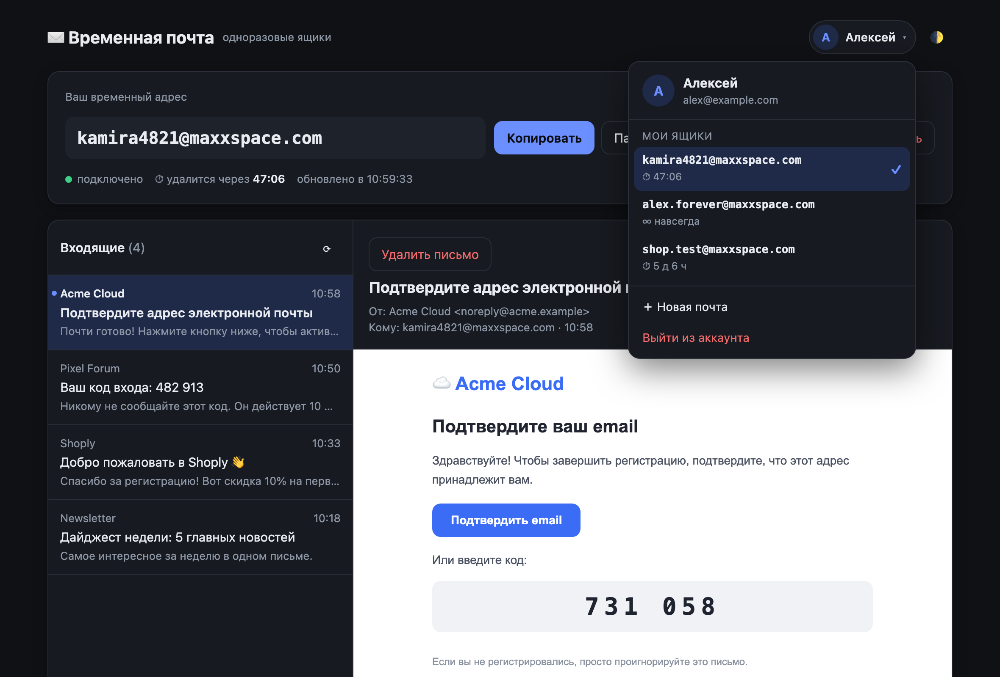
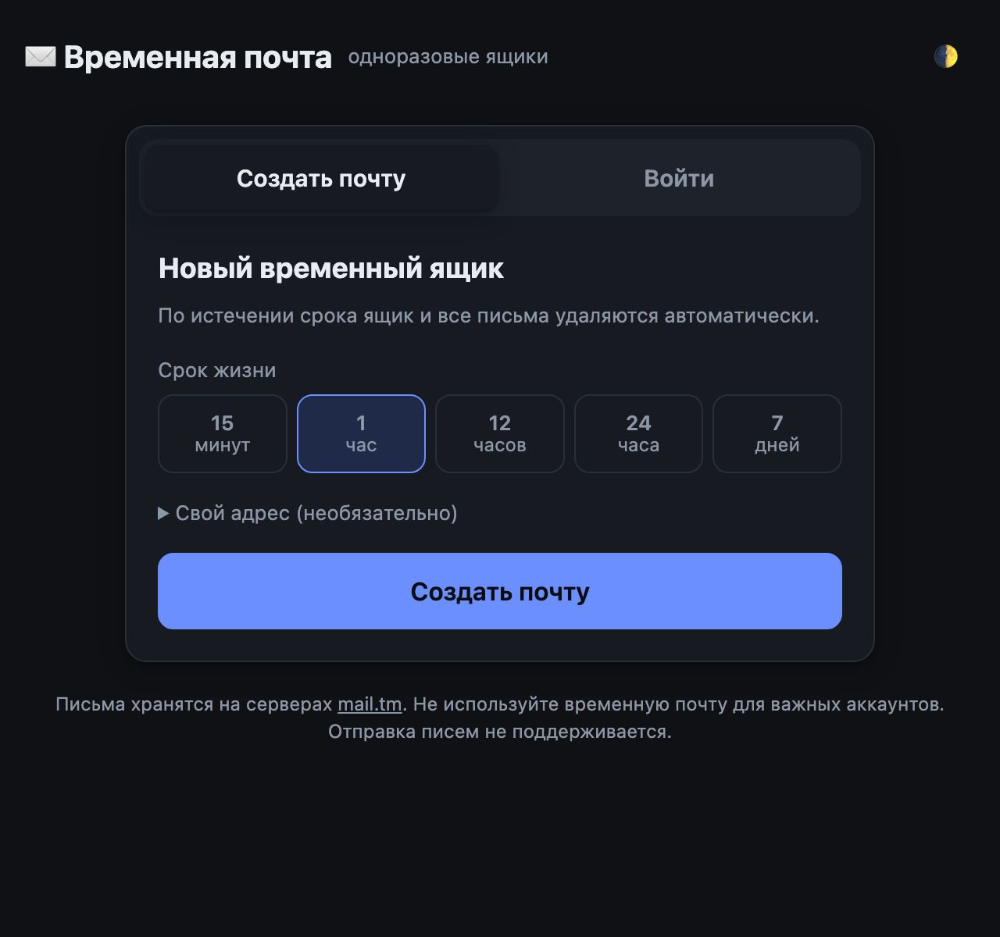
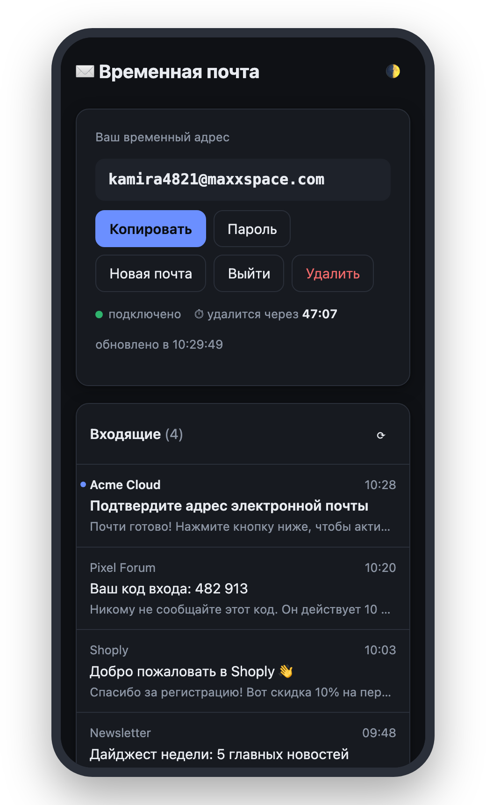
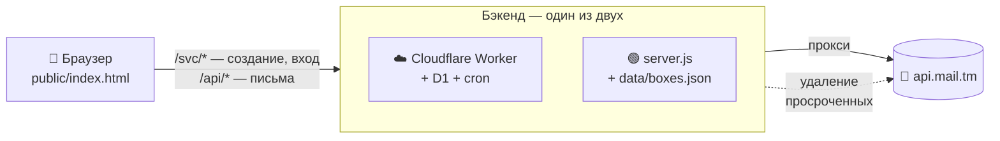

<div align="center">

# ✉️ Временная почта

**Одноразовые почтовые ящики в один клик — со сроком жизни от 15 минут до недели.**

Регистрируйтесь где угодно, не светя настоящий адрес: получите код, подтвердите аккаунт — и ящик сам исчезнет.

[](https://nodejs.org)
[](package.json)
[](https://docs.mail.tm)
[](LICENSE)
[](https://wilberods-coder.github.io/temp-mail/)
[](worker)

### [🌐 Открыть сайт → wilberods-coder.github.io/temp-mail](https://wilberods-coder.github.io/temp-mail/)

[**Возможности**](#-возможности) · [**Быстрый старт**](#-быстрый-старт) · [**Деплой**](#%EF%B8%8F-деплой) · [**Как это работает**](#%EF%B8%8F-как-это-работает) · [**API**](#-api)

<br>

<picture>
  <source media="(prefers-color-scheme: dark)" srcset="docs/inbox-dark.png">
  <source media="(prefers-color-scheme: light)" srcset="docs/inbox-light.png">
  
</picture>

</div>

---

## ✨ Возможности

<table>
<tr>
<td width="50%" valign="top">

### ⏱ Срок жизни на выбор
**15 минут · 1 час · 12 часов · 24 часа · 7 дней.**
Обратный отсчёт прямо в ящике, а по истечении срока сервер сам удаляет ящик вместе со всеми письмами — даже если вкладка давно закрыта.

### 🔑 Вход с любого устройства
У каждого ящика есть пароль: создали на компьютере — открыли на телефоне по адресу и паролю.

### 📬 Живые входящие
Проверка каждые 5 секунд, тост и системное уведомление о новом письме, пометка непрочитанных.

</td>
<td width="50%" valign="top">

### 🛡 Безопасный просмотр
HTML-письма открываются в изолированном `iframe` без права запускать скрипты; ссылки — в новой вкладке без `referrer`.

### 🗂 Несколько ящиков
Держите сразу несколько адресов и переключайтесь между ними. Свой логин и выбор домена — по желанию.

### 🎨 Приятно пользоваться
Тёмная и светлая темы, адаптивная вёрстка под телефон, вложения скачиваются в один клик.

</td>
</tr>
</table>

<div align="center">
<picture>
  <source media="(prefers-color-scheme: dark)" srcset="docs/landing-dark.png">
  <source media="(prefers-color-scheme: light)" srcset="docs/landing-light.png">
  
</picture>
&nbsp;&nbsp;

</div>

## 🚀 Быстрый старт

Проще всего — открыть **[готовый сайт](https://wilberods-coder.github.io/temp-mail/)**. Чтобы запустить у себя, нужен только **Node.js 18+** — никаких `npm install`.

```bash
git clone https://github.com/wilberods-coder/temp-mail.git
cd temp-mail
npm start
```

Откройте **http://127.0.0.1:5190** — готово.

| Переменная | По умолчанию | Описание |
|---|---|---|
| `PORT` | `5190` | Порт сервера |
| `HOST` | `127.0.0.1` | Адрес; для сервера/контейнера — `0.0.0.0` |

## ☁️ Деплой

> [!IMPORTANT]
> mail.tm разрешает запросы из браузера только со своего сайта, поэтому одной статической страницы мало — нужен прокси. В репозитории их два: [`server.js`](server.js) (Node.js) и [`worker/`](worker) (Cloudflare Worker).

### GitHub Pages + Cloudflare Worker — бесплатно и без сервера

Так работает [живая версия](https://wilberods-coder.github.io/temp-mail/): страница лежит на GitHub Pages, API — на Cloudflare Workers, сроки ящиков — в базе Cloudflare D1, удаление просроченных — по cron раз в минуту.

1. **Worker** (нужен бесплатный аккаунт Cloudflare):

   ```bash
   cd worker
   npm install
   npx wrangler login
   npx wrangler d1 create temp-mail   # вставьте database_id в wrangler.toml
   npm run db:init
   npm run deploy                     # выведет https://temp-mail.<ваш-поддомен>.workers.dev
   ```

2. **Настройка.** Впишите адрес Worker'а в [`public/config.js`](public/config.js), а адрес своего сайта (`https://<логин>.github.io`) — в `ALLOWED_ORIGINS` в [`worker/wrangler.toml`](worker/wrangler.toml), затем повторите `npm run deploy`.

3. **Pages.** В репозитории: *Settings → Pages → Source: GitHub Actions*. Дальше каждый пуш в `public/` выкладывается автоматически через [`pages.yml`](.github/workflows/pages.yml).

### Render — в один клик

[](https://render.com/deploy?repo=https://github.com/wilberods-coder/temp-mail)

Конфигурация лежит в [`render.yaml`](render.yaml). На бесплатном тарифе диск не сохраняется между перезапусками — сроки уже созданных ящиков при рестарте забудутся (сами ящики останутся в mail.tm).

### Docker

```bash
docker build -t temp-mail .
docker run -d -p 5190:5190 -v temp-mail-data:/app/data --name temp-mail temp-mail
```

Том `/app/data` хранит сроки ящиков между перезапусками.

### Любой VPS

```bash
HOST=0.0.0.0 PORT=80 node server.js
```

Для продакшена поставьте перед ним nginx/Caddy с HTTPS и запускайте через systemd или pm2.

## ⚙️ Как это работает



- **`public/index.html`** — весь интерфейс в одном файле: HTML, CSS и JS без сборки и фреймворков. [`config.js`](public/config.js) выбирает бэкенд: на github.io — Worker, иначе — тот же сервер, что отдал страницу.
- **`worker/`** — бэкенд для GitHub Pages на Cloudflare Workers: сроки в D1, cron раз в минуту.
- **`server.js`** — тот же бэкенд на чистом Node.js (~250 строк) для своего сервера: отдаёт страницу, сроки хранит в `data/boxes.json`, проверяет их каждые 30 секунд.
- **Сроки жизни.** У mail.tm их нет, поэтому бэкенд запоминает каждый созданный ящик и сам удаляет просроченные. Если страница открыта в момент истечения, ящик удаляется сразу.

## 📡 API

Одинаковое у `server.js` и Worker'а (`https://temp-mail.wilberods.workers.dev`). Собственные эндпоинты (всё остальное — прозрачный прокси `/api/*` → [api.mail.tm](https://docs.mail.tm)):

| Метод | Путь | Тело | Ответ |
|---|---|---|---|
| `POST` | `/svc/boxes` | `{ lifetime, login?, domain? }` | `201 { id, address, password, token, expiresAt }` |
| `POST` | `/svc/login` | `{ address, password }` | `200 { id, address, password, token, expiresAt }` |
| `POST` | `/svc/forget` | `{ id, password }` | `200 { ok: true }` |

`lifetime` — одно из `15m`, `1h`, `12h`, `24h`, `7d`. `expiresAt` — Unix-время в мс, `null` для ящиков, созданных не через этот сервис.

```bash
curl -X POST http://127.0.0.1:5190/svc/boxes \
  -H 'Content-Type: application/json' \
  -d '{"lifetime":"15m"}'
```

## 📁 Структура

```
temp-mail/
├── public/
│   ├── index.html         # интерфейс
│   └── config.js          # адрес бэкенда
├── worker/                # бэкенд на Cloudflare Workers (для GitHub Pages)
│   ├── src/index.js
│   ├── schema.sql         # таблица D1
│   └── wrangler.toml
├── server.js              # бэкенд на Node.js: статика + прокси + сроки жизни
├── data/                  # boxes.json для server.js (в .gitignore)
├── docs/                  # скриншоты для README
├── .github/workflows/
│   └── pages.yml          # выкладка public/ на GitHub Pages
├── Dockerfile
└── render.yaml
```

## ⚠️ Ограничения

- **Только приём** писем — отправка не поддерживается.
- **Лимит mail.tm** — около 30 запросов в минуту с одного IP. На сервере все пользователи делят его IP, так что сервис рассчитан на личное или небольшое использование.
- **Бэкенд хранит пароли ящиков** (`data/boxes.json` или база D1), чтобы удалить ящик по истечении срока. Не публикуйте их — `data/` уже в `.gitignore`.
- Не используйте временную почту для важных аккаунтов: восстановить доступ после удаления ящика будет невозможно.

## 🙏 Благодарности

Почтовый бэкенд — бесплатный публичный API [mail.tm](https://mail.tm).

## 📄 Лицензия

[MIT](LICENSE)
